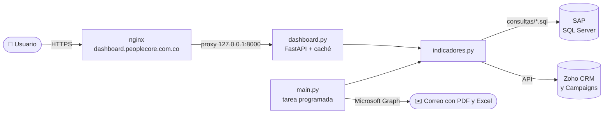

<div align="center">

# 📊 Indicadores de gestión

**Dashboard en tiempo real y reporte por correo de los indicadores de gestión,**
**calculados desde SAP Business One (SQL Server) y Zoho CRM / Campaigns.**


[Localhost](#-trabajar-en-localhost-windows) ·
[Servidor Ubuntu](#-publicar-en-el-servidor-ubuntu-con-nginx) ·
[Actualizar](#-actualizar-el-servidor) ·
[Tareas frecuentes](#-tareas-frecuentes) ·
[Problemas](#-solución-de-problemas)

</div>

---

## ✨ Qué hace

| | Salida | Descripción |
|---|---|---|
| 🖥️ | **Dashboard web** (`dashboard.py`) | Tablero tipo Power BI: resumen general con semáforo de cumplimiento, una vista por proceso, gráficos interactivos, tablas mensuales y descarga a Excel. Datos en vivo con caché de 5 minutos. |
| ✉️ | **Reporte por correo** (`main.py`) | Genera un PDF y un Excel por proceso y los envía con Microsoft Graph. |

Las dos salidas usan la misma definición de indicadores (`indicadores.py` + `consultas/*.sql`): **un indicador nuevo aparece en ambas sin tocar nada más**.

### Arquitectura



---

## 📁 Estructura del proyecto

<details>
<summary>Ver árbol de archivos</summary>

```text
indicadores/
├── dashboard.py              # Servidor web (FastAPI): login, API y caché
├── crear_usuario.py          # Genera usuarios para el dashboard
├── main.py                   # Reporte PDF/Excel por correo
├── indicadores.py            # Definición de los indicadores (metas, columnas, proceso)
├── consultas/                # Un .sql por indicador de SAP
├── datos.py                  # Conexión a SQL Server y ejecución de consultas
├── zoho.py                   # Descarga de oportunidades y cuentas de Zoho CRM
├── zoho_campaigns.py         # Descarga de campañas y listas de Zoho Campaigns
├── zoho_indicadores.py       # Indicadores calculados con datos de Zoho
├── reporte.py                # Excel y cuerpo del correo
├── reporte_pdf.py            # PDF por proceso
├── graficos.py               # Gráficos del PDF y formato de números
├── correo.py                 # Envío con Microsoft Graph
├── web/
│   ├── index.html            # Dashboard
│   ├── login.html            # Pantalla de ingreso
│   └── static/               # estilos.css, app.js y vendor/echarts
├── deploy/
│   ├── nginx-dashboard.conf            # Sitio de nginx
│   └── indicadores-dashboard.service   # Servicio systemd
├── requirements.txt
├── .env.example              # Plantilla de configuración
└── .env                      # Credenciales reales (ignorado por git)
```

</details>

---

## ⚙️ Variables de entorno

Copia `.env.example` como `.env` y complétalo.

> [!CAUTION]
> El `.env` tiene contraseñas y tokens. Está en `.gitignore`: **nunca lo subas al repositorio**.

<details>
<summary>Ver todas las variables</summary>

| Variable | Ejemplo | Para qué |
|---|---|---|
| `SQL_SERVER`, `SQL_PORT`, `SQL_DATABASE`, `SQL_USER`, `SQL_PASSWORD` | | Conexión a la base de SAP |
| `SQL_DRIVER` | `ODBC Driver 18 for SQL Server` | Driver ODBC instalado en la máquina |
| `SQL_TRUST_CERT` | `yes` | Confiar en el certificado del SQL Server |
| `GRAPH_TENANT_ID`, `GRAPH_CLIENT_ID`, `GRAPH_CLIENT_SECRET` | | App de Azure para enviar el correo |
| `MAIL_FROM`, `MAIL_TO` | `a@empresa.com,b@empresa.com` | Remitente y destinatarios del reporte |
| `ZOHO_CLIENT_ID`, `ZOHO_CLIENT_SECRET`, `ZOHO_REFRESH_TOKEN` | | Acceso a la API de Zoho |
| `ZOHO_ETAPAS_GANADA`, `ZOHO_ETAPAS_PERDIDA` | `Cerrado Ganado` | Etapas de Zoho que cuentan como ganada o perdida |
| `DASHBOARD_USUARIOS` | `ruben:<hash>,ana:<hash>` | Usuarios del dashboard (se generan con `crear_usuario.py`) |
| `DASHBOARD_SECRET` | 64 caracteres aleatorios | Firma la cookie de sesión. **Distinto en local y en el servidor** |
| `DASHBOARD_CACHE_MIN` | `5` | Cada cuántos minutos se vuelve a consultar SAP y Zoho |
| `DASHBOARD_HTTPS` | `0` local · `1` servidor | Con `1` la cookie de sesión solo viaja por HTTPS |

</details>

Para generar un `DASHBOARD_SECRET`:

```bash
python -c "import secrets; print(secrets.token_hex(32))"
```

---

## 💻 Trabajar en localhost (Windows)

### Requisitos

- [x] Python 3.10 o superior
- [x] [Microsoft ODBC Driver 18 for SQL Server](https://learn.microsoft.com/sql/connect/odbc/download-odbc-driver-for-sql-server)
- [x] Acceso de red al SQL Server de SAP desde el equipo

### 1. Clonar e instalar

```powershell
git clone https://github.com/rubendario21/indicadores.git
cd indicadores

python -m venv .venv
.venv\Scripts\python -m pip install -r requirements.txt

copy .env.example .env      # y completa los valores
```

### 2. Crear tu usuario

```powershell
.venv\Scripts\python crear_usuario.py ruben
```

Pide la contraseña dos veces (mínimo 8 caracteres) e imprime una línea `ruben:<sal>$<hash>`. Pégala en el `.env`:

```ini
DASHBOARD_USUARIOS=ruben:<sal>$<hash>
```

> [!TIP]
> Para varios usuarios, sepáralos con coma: `DASHBOARD_USUARIOS=ruben:...,gerencia:...,comercial:...`

### 3. Arrancar el dashboard

```powershell
.venv\Scripts\uvicorn dashboard:app --reload --port 8000
```

Abre **<http://localhost:8000>** e ingresa con tu usuario.

> [!NOTE]
> La **primera carga tarda unos 10 a 20 segundos** porque consulta SAP y Zoho. Después responde al instante desde la caché.
> `--reload` reinicia el servidor solo cuando guardas cambios en el código. Para detenerlo: <kbd>Ctrl</kbd> + <kbd>C</kbd>.

### 4. Comprobar que funciona

```powershell
curl http://localhost:8000/salud
# {"ok":true}
```

En la consola de uvicorn verás:

```text
INFO Ingreso: ruben
INFO Indicadores 2026 calculados en 6.7 s
```

### Reporte por correo

```powershell
.venv\Scripts\python main.py --prueba   # genera los archivos en salida\ sin enviar nada
.venv\Scripts\python main.py            # genera y envía el correo
```

---

## 🚀 Publicar en el servidor Ubuntu con nginx

**Resultado:** `https://dashboard.peoplecore.com.co` → nginx (HTTPS) → uvicorn en `127.0.0.1:8000` → SAP y Zoho.

Probado en Ubuntu 22.04 y 24.04.

### Paso 0 · Antes de empezar

> [!IMPORTANT]
> **1. DNS:** en el administrador del dominio `peoplecore.com.co`, crea un registro **A** con nombre `dashboard` que apunte a la IP pública del servidor Ubuntu.
>
> **2. Firewall del SQL Server:** pide que permitan la **IP pública del servidor Ubuntu** hacia el SQL Server de SAP (puerto `1433`). Sin esto el dashboard no puede consultar SAP.

Verifica el DNS desde tu equipo (puede tardar unos minutos en propagarse):

```powershell
nslookup dashboard.peoplecore.com.co
```

### Paso 1 · Paquetes del sistema

```bash
sudo apt update
sudo apt install -y git python3 python3-venv python3-pip nginx certbot python3-certbot-nginx curl gnupg
```

### Paso 2 · Driver ODBC 18 de SQL Server

```bash
curl -fsSL https://packages.microsoft.com/keys/microsoft.asc \
  | sudo gpg --dearmor -o /usr/share/keyrings/microsoft-prod.gpg

curl -fsSL https://packages.microsoft.com/config/ubuntu/$(lsb_release -rs)/prod.list \
  | sudo tee /etc/apt/sources.list.d/mssql-release.list

sudo apt update
sudo ACCEPT_EULA=Y apt install -y msodbcsql18 unixodbc-dev

odbcinst -q -d      # debe mostrar [ODBC Driver 18 for SQL Server]
```

### Paso 3 · Descargar el código

```bash
# Usuario de sistema sin acceso por SSH, solo para correr el dashboard
sudo useradd --system --home /opt/indicadores --shell /usr/sbin/nologin indicadores

sudo git clone https://github.com/rubendario21/indicadores.git /opt/indicadores
```

> [!NOTE]
> Si el repositorio es privado, `git clone` pedirá autenticación. Usa un [token de acceso personal](https://github.com/settings/tokens) de solo lectura o una [deploy key](https://docs.github.com/authentication/connecting-to-github-with-ssh/managing-deploy-keys).

### Paso 4 · Entorno de Python

```bash
cd /opt/indicadores
sudo python3 -m venv .venv
sudo .venv/bin/pip install --upgrade pip
sudo .venv/bin/pip install -r requirements.txt
```

### Paso 5 · Configuración (.env)

El `.env` no viene en el repositorio. Créalo desde la plantilla:

```bash
sudo cp /opt/indicadores/.env.example /opt/indicadores/.env
sudo nano /opt/indicadores/.env
```

O súbelo desde tu equipo Windows y muévelo:

```powershell
scp C:\wamp64\www\Python\indicadores\.env usuario@IP_DEL_SERVIDOR:/tmp/indicadores.env
```

```bash
sudo mv /tmp/indicadores.env /opt/indicadores/.env
```

En el servidor, estos valores **deben** quedar así:

```ini
SQL_DRIVER=ODBC Driver 18 for SQL Server
SQL_TRUST_CERT=yes
DASHBOARD_HTTPS=1
DASHBOARD_SECRET=<uno nuevo, distinto al de tu equipo>
DASHBOARD_USUARIOS=<los usuarios de producción>
```

Genera el secreto y los usuarios directamente en el servidor:

```bash
python3 -c "import secrets; print(secrets.token_hex(32))"
cd /opt/indicadores && sudo .venv/bin/python crear_usuario.py gerencia
```

### Paso 6 · Permisos

```bash
sudo chown -R indicadores:indicadores /opt/indicadores
sudo chmod 600 /opt/indicadores/.env        # solo el usuario del servicio lee las credenciales
sudo chmod 755 /opt/indicadores /opt/indicadores/web /opt/indicadores/web/static
sudo git config --system --add safe.directory /opt/indicadores
```

### Paso 7 · Probar SQL Server y Zoho

```bash
cd /opt/indicadores
sudo -u indicadores .venv/bin/python -c "
from sqlalchemy import text
from datos import crear_engine
with crear_engine().connect() as c:
    print('SQL Server OK:', c.execute(text('SELECT 1')).scalar())
from zoho import _token
_token(); print('Zoho OK')
"
```

Si falla SQL Server, revisa el [Paso 0](#paso-0--antes-de-empezar) y la [solución de problemas](#-solución-de-problemas).

### Paso 8 · Servicio systemd

Arranca solo con el servidor y se reinicia si falla.

```bash
sudo cp /opt/indicadores/deploy/indicadores-dashboard.service /etc/systemd/system/
sudo systemctl daemon-reload
sudo systemctl enable --now indicadores-dashboard

sudo systemctl status indicadores-dashboard     # debe decir "active (running)"
curl http://127.0.0.1:8000/salud                # {"ok":true}
```

> [!NOTE]
> El servicio usa **un solo worker** a propósito: la caché de indicadores vive en la memoria del proceso. Las peticiones simultáneas se atienden con hilos, así que no hace falta más.

### Paso 9 · nginx

```bash
sudo cp /opt/indicadores/deploy/nginx-dashboard.conf /etc/nginx/sites-available/dashboard.peoplecore.com.co
sudo ln -s /etc/nginx/sites-available/dashboard.peoplecore.com.co /etc/nginx/sites-enabled/
sudo nginx -t
sudo systemctl reload nginx
```

La configuración ya incluye:

- Proxy hacia uvicorn (`127.0.0.1:8000`) con timeout de 120 s para la primera consulta.
- Archivos estáticos servidos directamente por nginx.
- Límite de 10 intentos de login por minuto por IP.
- Cabeceras de seguridad básicas.

En este punto `http://dashboard.peoplecore.com.co` ya debe mostrar la pantalla de ingreso.

### Paso 10 · HTTPS con Let's Encrypt

```bash
sudo certbot --nginx -d dashboard.peoplecore.com.co
sudo certbot renew --dry-run      # comprueba la renovación automática
```

Acepta redirigir HTTP a HTTPS cuando lo pregunte.

> [!WARNING]
> El dashboard muestra márgenes y ventas: **no lo dejes publicado sin HTTPS**. Con `DASHBOARD_HTTPS=1`, la sesión no funciona por HTTP plano.

### Paso 11 · Firewall del servidor

```bash
sudo ufw allow OpenSSH
sudo ufw allow 'Nginx Full'
sudo ufw enable
sudo ufw status
```

El puerto `8000` **no** se abre: uvicorn solo escucha en `127.0.0.1` y únicamente nginx lo ve.

### ✅ Listo

Entra a **<https://dashboard.peoplecore.com.co>**.

---

## 🔄 Actualizar el servidor

En tu equipo, sube los cambios:

```powershell
git add .
git commit -m "Descripción del cambio"
git push
```

En el servidor, descárgalos y reinicia:

```bash
cd /opt/indicadores
sudo git pull
sudo .venv/bin/pip install -r requirements.txt      # solo si cambió requirements.txt
sudo chown -R indicadores:indicadores /opt/indicadores
sudo systemctl restart indicadores-dashboard
```

> [!TIP]
> `git pull` nunca toca el `.env` del servidor, porque no está en el repositorio.

---

## 🧰 Tareas frecuentes

<details>
<summary><b>Agregar un indicador</b></summary>

No hay que tocar nada del dashboard:

1. Crea el `.sql` en `consultas/`, o la función en `zoho_indicadores.py`.
2. Agrega su `Indicador(...)` en `indicadores.py`.
3. Reinicia: en local se recarga solo con `--reload`; en el servidor, `sudo systemctl restart indicadores-dashboard`.

</details>

<details>
<summary><b>Agregar o quitar un usuario</b></summary>

1. Ejecuta `python crear_usuario.py nombre` y agrega la línea a `DASHBOARD_USUARIOS`, o borra la del usuario que quieres quitar.
2. Reinicia el servicio.
3. Al quitar a alguien, cambia también `DASHBOARD_SECRET` para cerrar las sesiones abiertas.

</details>

<details>
<summary><b>Cambiar cada cuánto se consulta SAP y Zoho</b></summary>

Ajusta `DASHBOARD_CACHE_MIN` en el `.env` (por defecto 5 minutos) y reinicia el servicio. Funciona así:

- Vencida la caché, la página entrega el último dato al instante y consulta de nuevo en segundo plano. La pantalla se actualiza sola en menos de un minuto.
- El botón **Actualizar** fuerza la consulta en el momento. Se puede usar como máximo una vez por minuto, para no sobrecargar SAP.

</details>

<details>
<summary><b>Ver logs, reiniciar o detener</b></summary>

```bash
sudo journalctl -u indicadores-dashboard -f            # logs del dashboard
sudo tail -f /var/log/nginx/error.log                  # errores de nginx

sudo systemctl restart indicadores-dashboard
sudo systemctl stop indicadores-dashboard
sudo systemctl status indicadores-dashboard
```

</details>

---

## 🩺 Solución de problemas

| Síntoma | Causa probable | Qué hacer |
|---|---|---|
| `502 Bad Gateway` | El servicio no está corriendo | `sudo systemctl status indicadores-dashboard` y `journalctl -u indicadores-dashboard -n 50` |
| `504 Gateway Timeout` en la primera carga | SAP o Zoho tardaron más de 120 s | Revisa la conectividad o sube `proxy_read_timeout` en nginx |
| `Can't open lib 'ODBC Driver 18 for SQL Server'` | Driver no instalado o nombre distinto | `odbcinst -q -d` y copia el nombre exacto en `SQL_DRIVER` |
| `Login timeout expired` · `TCP Provider` | El firewall del SQL Server bloquea la IP del servidor | Pide que permitan la IP del Ubuntu ([Paso 0](#paso-0--antes-de-empezar)) |
| `certificate verify failed` | Certificado del SQL Server no confiable | `SQL_TRUST_CERT=yes` en el `.env` |
| Ingresa pero vuelve al login | `DASHBOARD_HTTPS=1` y se entró por `http://` | Entra siempre por `https://`; en local usa `DASHBOARD_HTTPS=0` |
| "Usuario o contraseña incorrectos" | Usuario mal copiado o servicio sin reiniciar | Revisa `DASHBOARD_USUARIOS` y reinicia |
| Un indicador sale **Con error** | Falla de su consulta SQL o de Zoho | El mensaje aparece en la tarjeta; el detalle completo, en los logs |
| `Zoho no entregó el token` | Refresh token vencido o revocado | Genera un nuevo `ZOHO_REFRESH_TOKEN` en la consola de Zoho |
| Los gráficos no aparecen | Falta `web/static/vendor/echarts-5.5.1.min.js` | Verifica que el archivo está en el servidor |
| `git pull` dice *dubious ownership* | El repositorio pertenece al usuario `indicadores` | `sudo git config --system --add safe.directory /opt/indicadores` |
